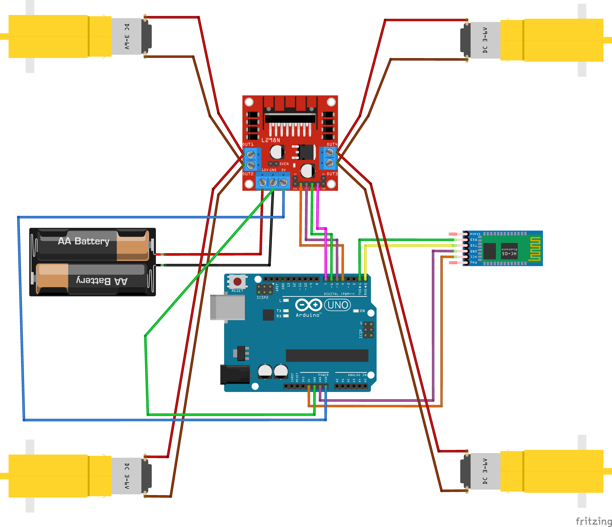

# Arduino Bluetooth-controlled Car (4WD)

## Wiring

### Arduino to L298N

| Arduino pin | L298N |
|---|---|
| 4 | IN1 |
| 5 | IN2 |
| 6 | IN3 |
| 7 | IN4 |
| GND | GND |

Keep the **ENA** and **ENB** jumper caps on.

### Motors to L298N

Two motors per side, wired in parallel to the same terminals. Use the same wire pairing on both motors of a side.

| Side | L298N terminals |
|---|---|
| Left (top + bottom) | OUT1 / OUT2 |
| Right (top + bottom) | OUT3 / OUT4 |

__Motors have no polarity. If a side spins the wrong way, swap its two wires.__

### Arduino to HC-05

| HC-05 | Arduino |
|---|---|
| VCC | 5V |
| GND | GND |
| TXD | 0 (RX) |
| RXD | 1 (TX), through a voltage divider |

Voltage divider for RXD: 1k from pin 1 to RXD, 2k from RXD to GND (HC-05 data pins are 3.3V).

### Power

- Battery **+** to L298N **12V**, battery **-** to L298N **GND**.
- L298N **GND** to Arduino **GND** (a common ground is required).
- Use 4xAA (6V) or 2x18650 (7.4V). Two AA (3V) is too low because the L298N drops about 2V.
- Power the Arduino over USB, or from the L298N **5V** screw to the Arduino **5V** pin (only with a battery of about 7V or more). Do not feed 5V into Vin.

__Use an app that sends the letter on press and the lowercase letter on release (for example, Arduino Bluetooth RC Car).__

## Upload and use

1. **Unplug the HC-05 wires from pins 0 and 1** (they share the USB serial port).
2. Open `Arduino-BT-Code.ino` in the Arduino IDE and upload it to the Uno.
3. Reconnect the HC-05 wires.
4. Pair your phone with the HC-05 (default PIN `1234` or `0000`).
5. Open the RC app, connect, and drive. Test with the wheels off the ground first.
